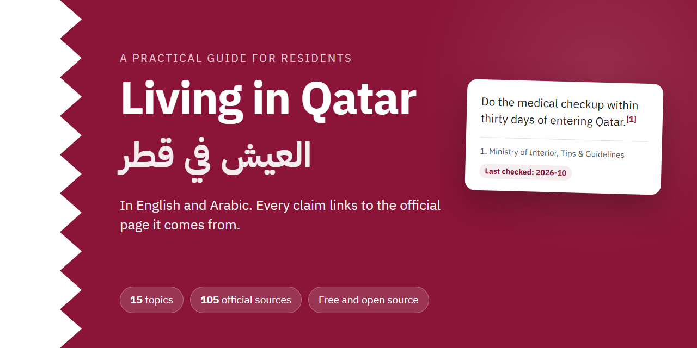
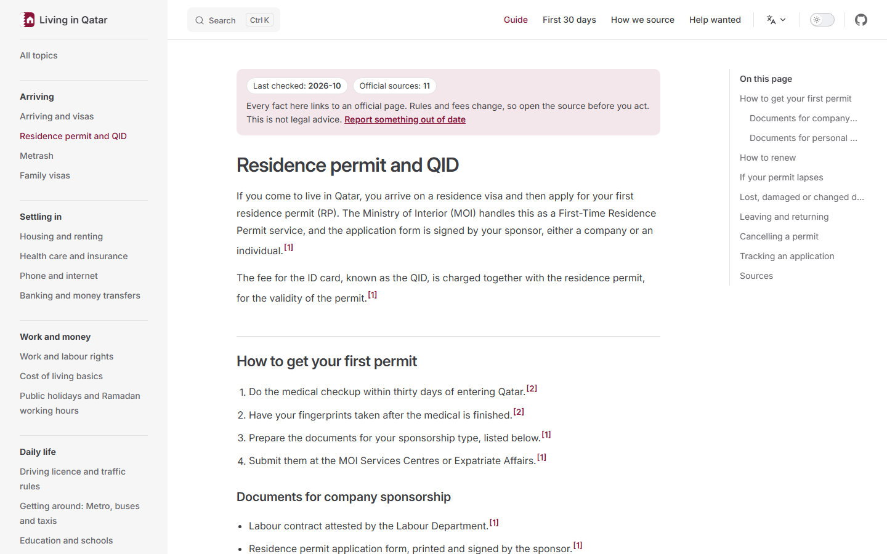
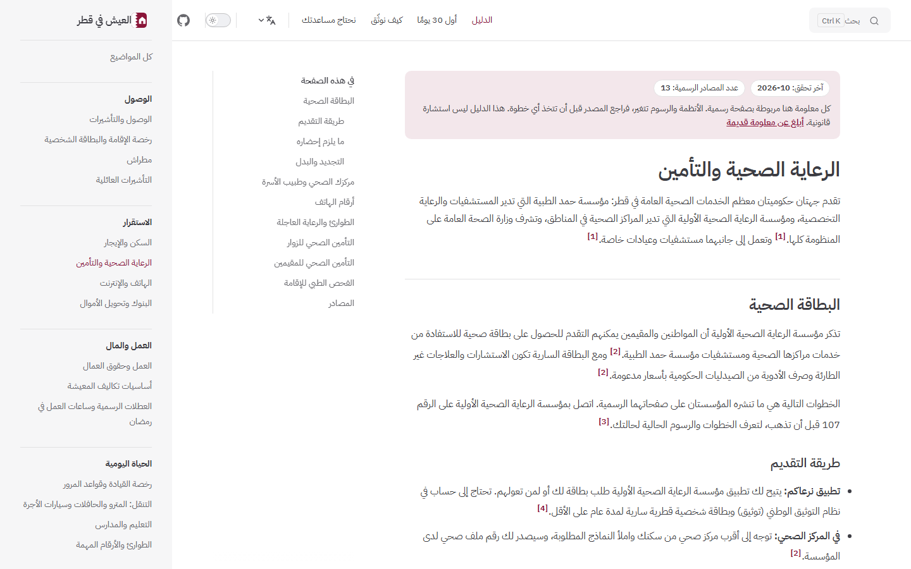
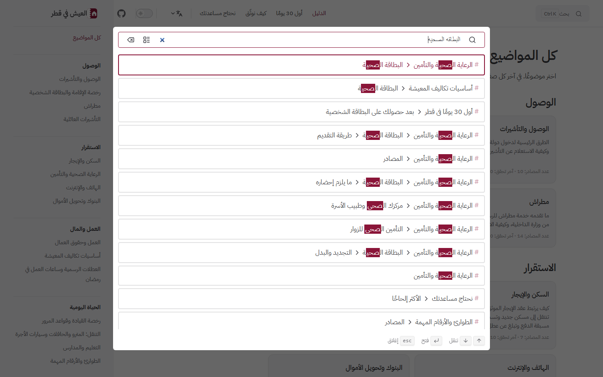
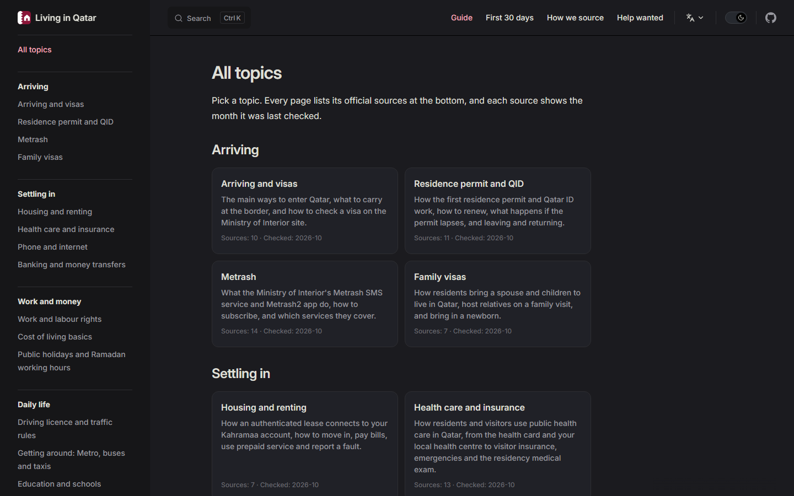
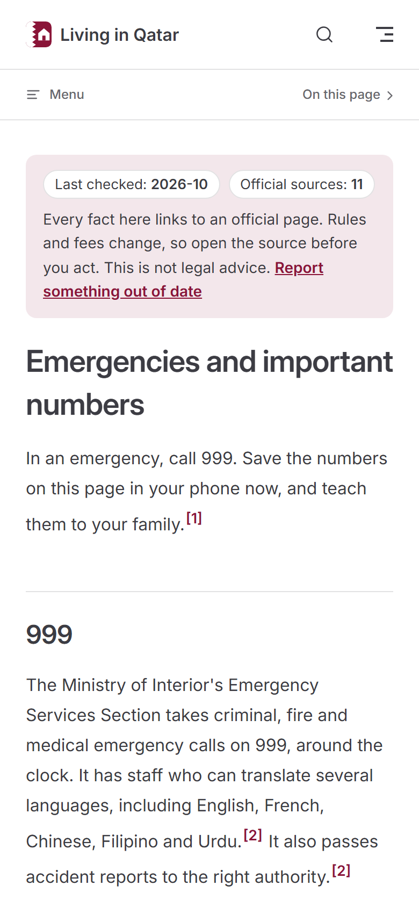
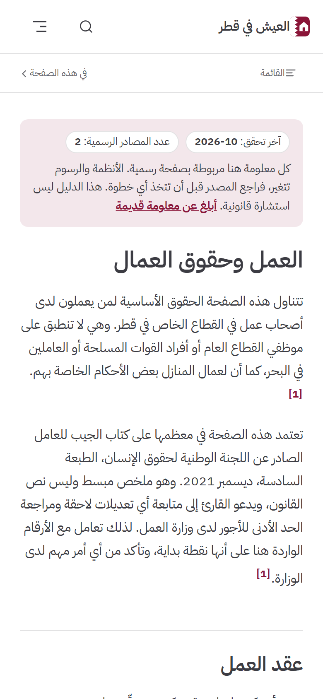
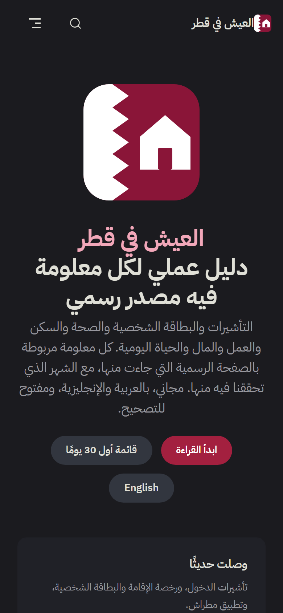
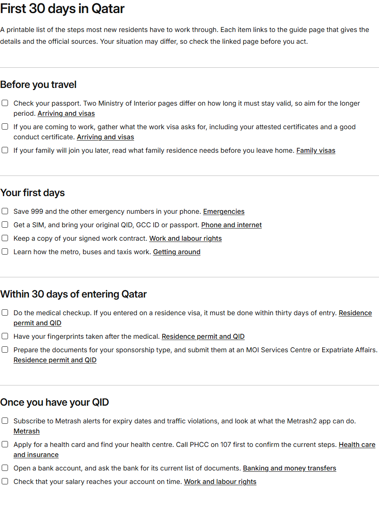

<div align="center">



<br><br>

[](docs/sourcing.md)
[](#whats-inside)
[](https://ifazawezk.github.io/living-in-qatar/ar/)
[](#how-we-source-things)
[](CONTRIBUTING.md)
[](LICENSE-CONTENT)
[](LICENSE)

**A free, practical guide to living in Qatar, in English and Arabic.<br>Every claim links to the official page it comes from, with the month it was last checked.**

[Read the guide](https://ifazawezk.github.io/living-in-qatar/) &nbsp;·&nbsp; [اقرأ الدليل بالعربية](https://ifazawezk.github.io/living-in-qatar/ar/) &nbsp;·&nbsp; [First 30 days checklist](https://ifazawezk.github.io/living-in-qatar/checklist) &nbsp;·&nbsp; [Help wanted](docs/help-wanted.md)

</div>

## Start here

| You are... | Read these, in this order | بالعربية |
| --- | --- | --- |
| **Just arrived** | [Arriving and visas](docs/guide/arriving-and-visas.md), [Residence permit and QID](docs/guide/residence-permit-and-qid.md), [Metrash](docs/guide/metrash.md), [First 30 days checklist](docs/checklist.md) | [وصلت حديثًا](docs/ar/guide/arriving-and-visas.md) |
| **Looking for a job, or just started one** | [Work and labour rights](docs/guide/work-and-labour-rights.md), [Banking and money transfers](docs/guide/banking-and-money.md), [Public holidays and Ramadan hours](docs/guide/holidays-and-ramadan.md) | [تبحث عن عمل](docs/ar/guide/work-and-labour-rights.md) |
| **Bringing your family** | [Family visas](docs/guide/family-visas.md), [Education and schools](docs/guide/education.md), [Health care and insurance](docs/guide/health.md) | [ستستقدم عائلتك](docs/ar/guide/family-visas.md) |
| **Renting a home** | [Housing and renting](docs/guide/housing-and-utilities.md), [Phone and internet](docs/guide/phone-and-internet.md), [Cost of living basics](docs/guide/cost-of-living.md) | [تستأجر سكنًا](docs/ar/guide/housing-and-utilities.md) |

## Why

If you are new in Qatar, you get your answers from group chats, forum threads and blog posts. Some of that advice is good. A lot of it is years old, and almost none of it says where it came from. The official pages exist, but they are spread across many ministries and sites, and you have to know where to look.

This guide is built on one rule: **if we cannot point to an official page for a fact, the fact does not go in.**

| | Forums and group chats | Blogs and explainers | Relocation and insurer guides | This guide |
| --- | --- | --- | --- | --- |
| Each claim links to the official page | Rarely | Sometimes | Rarely | **Yes, enforced by a script** |
| Shows when each source was last checked | No | Publish date at best | No | **Yes, on every source** |
| English and Arabic with the same sources | Mixed | Usually one language | Usually English | **Yes, enforced by a script** |
| Readers can correct it | In replies | No | No | **Yes, by pull request** |
| Admits what it could not confirm | No | No | No | **Yes, in [Help wanted](docs/help-wanted.md)** |
| Free, no ads, no sign-up | Yes | Often ads | Often lead forms | **Yes** |

## What's inside

15 topics, each in English and Arabic, backed by 106 official pages and 262 source citations.

| Topic | بالعربية | Sources |
| --- | --- | --- |
| [Arriving and visas](docs/guide/arriving-and-visas.md) | [الوصول والتأشيرات](docs/ar/guide/arriving-and-visas.md) | 10 |
| [Residence permit and QID](docs/guide/residence-permit-and-qid.md) | [رخصة الإقامة والبطاقة الشخصية](docs/ar/guide/residence-permit-and-qid.md) | 11 |
| [Metrash](docs/guide/metrash.md) | [مطراش](docs/ar/guide/metrash.md) | 14 |
| [Family visas](docs/guide/family-visas.md) | [التأشيرات العائلية](docs/ar/guide/family-visas.md) | 7 |
| [Housing and renting](docs/guide/housing-and-utilities.md) | [السكن والإيجار](docs/ar/guide/housing-and-utilities.md) | 7 |
| [Health care and insurance](docs/guide/health.md) | [الرعاية الصحية والتأمين](docs/ar/guide/health.md) | 13 |
| [Phone and internet](docs/guide/phone-and-internet.md) | [الهاتف والإنترنت](docs/ar/guide/phone-and-internet.md) | 11 |
| [Banking and money transfers](docs/guide/banking-and-money.md) | [البنوك وتحويل الأموال](docs/ar/guide/banking-and-money.md) | 7 |
| [Work and labour rights](docs/guide/work-and-labour-rights.md) | [العمل وحقوق العمال](docs/ar/guide/work-and-labour-rights.md) | 3 |
| [Cost of living basics](docs/guide/cost-of-living.md) | [أساسيات تكاليف المعيشة](docs/ar/guide/cost-of-living.md) | 8 |
| [Public holidays and Ramadan working hours](docs/guide/holidays-and-ramadan.md) | [العطلات الرسمية وساعات العمل في رمضان](docs/ar/guide/holidays-and-ramadan.md) | 5 |
| [Driving licence and traffic rules](docs/guide/driving.md) | [رخصة القيادة وقواعد المرور](docs/ar/guide/driving.md) | 9 |
| [Getting around: Metro, buses and taxis](docs/guide/transport.md) | [التنقل: المترو والحافلات وسيارات الأجرة](docs/ar/guide/transport.md) | 6 |
| [Education and schools](docs/guide/education.md) | [التعليم والمدارس](docs/ar/guide/education.md) | 9 |
| [Emergencies and important numbers](docs/guide/emergencies.md) | [الطوارئ والأرقام المهمة](docs/ar/guide/emergencies.md) | 11 |

Plus a [printable first 30 days checklist](docs/checklist.md), and a [list of everything we could not confirm yet](docs/help-wanted.md).

## How we source things

1. **Official sources only.** Government of Qatar sites, public bodies for their own services, and licensed operators for their own services. The full list is in [`scripts/official_domains.txt`](scripts/official_domains.txt). News, forums, blogs, relocation firms and law firm articles are never cited.
2. **Exact page.** Each claim has a footnote to the specific page it came from, and that page was opened and read before it was cited.
3. **Dated.** Each footnote ends with the month it was last checked.
4. **Fees are linked, not copied.** We usually point to the official fee page, because amounts change.
5. **Conflicts are shown, not hidden.** When two official pages disagree, such as on passport validity, the guide says so and cites both.
6. **Gaps are public.** Anything we could not confirm is on the [Help wanted](docs/help-wanted.md) list instead of being guessed.

Read the full rules in [How we source things](docs/sourcing.md).

**A note on age.** Official does not always mean recent. Some Ministry of Interior service pages are old, and the labour page rests on a National Human Rights Committee booklet from December 2021, plus a January 2006 English copy of the law for the gratuity amount, because the current law text and Ministry of Labour pages could not be opened when this was written. Those pages say so. Please read them with that in mind, and help us replace them with something newer.

## Screenshots

Real captures of the built site.

| Desktop, English | Desktop, Arabic |
| --- | --- |
|  |  |

| Arabic search, typed with ه instead of ة | Dark mode |
| --- | --- |
|  |  |

| Phone, English | Phone, Arabic | Phone, Arabic, dark | Printed checklist |
| --- | --- | --- | --- |
|  |  |  |  |

## Features

- **Real right-to-left Arabic,** not a mirrored English page, with its own typeface and interface text.
- **Search that understands Arabic.** It runs in your browser and ignores differences in hamza, ta marbuta, alif maqsura, diacritics and the definite article, and it reads ٩٩٩ as 999.
- **Works on a phone,** with dark mode and no third-party scripts or fonts.
- **Printable checklist** that remembers your ticks in your own browser.
- **Edit link on every page,** plus a one-click report for anything out of date.

## Run it locally

You need Node.js 18 or newer and Python 3.10 or newer.

```bash
npm install
npm run dev     # http://localhost:5173/living-in-qatar/
npm run build   # production build in docs/.vitepress/dist
npm test        # search tests against the build, then the Python tests
```

The site is set up for GitHub Pages at `/living-in-qatar/`.

## Checking the sources

Two scripts keep the guide honest. Both use only the Python standard library.

```bash
python scripts/lint_content.py     # fails if any paragraph has no official source
python scripts/check_links.py      # visits every source link and reports problems
```

The lint fails if a paragraph, list item or table row has no official source, if a footnote has no date or links to an unlisted domain, or if the English and Arabic pages cite different sources.

The link checker sorts every link into `ok`, `moved`, `changed` (the title differs from [the saved baseline](scripts/link_baseline.json)), `blocked` (the site turned away an automated visitor, so a person must check it), `dead` or `unreachable`. Latest run:

```text
checking 106 links on 24 sites
0 dead, 3 unreachable, 0 moved, 0 changed, 5 blocked, 98 ok (106 links)
```

`blocked` and `unreachable` do not mean the page is gone. Some sites turn away scripts or did not answer from the network this ran on, so those links need a person with a browser.

## Contributing

Corrections from people who live here are what keep this useful. The quickest way is the edit link at the bottom of any page. Please read [CONTRIBUTING.md](CONTRIBUTING.md) first, because every change needs an official source.

Good first contributions:

- Pick an item from [Help wanted](docs/help-wanted.md) and link the official page.
- Open the `blocked` links in a browser and confirm they still say what the guide says.
- Improve a sentence of Arabic that reads like a translation.

## Roadmap

- [ ] Check the labour page against the law text and current Ministry of Labour pages
- [ ] Close the top gaps in Help wanted: Metrash registration, licensed exchange houses, rental law, resident health insurance
- [ ] Main traffic rules, from official sources
- [ ] New topics: domestic workers, starting a business, buying a car, leaving Qatar for good
- [ ] Scheduled link checks that open an issue when a source changes
- [ ] A downloadable PDF of the whole guide
- [ ] More languages for the communities who need this most, starting with Hindi, Urdu, Malayalam and Filipino

## FAQ

**Is this an official government website?**
No. It is a community project and is not run by, or connected to, any government body.

**Can I rely on this for a legal or financial decision?**
Use it to find the right official page, then read that page. For anything important, ask the authority directly.

**Why does a topic I need look thin?**
Because we only publish what we could confirm on an official page. A short page with sources is more useful than a long page you cannot check. If you can find the official page, please add it.

**Why are there so few fees and fines?**
They change often, and an old amount can cost you money. We link to the official page instead.

**Why do some sources look old?**
Some official pages are old and are still the only ones we could read. Where it matters, the guide says so.

**Does the site track me?**
It has no analytics, no cookies and no third-party scripts or fonts. Your theme and checklist ticks are stored in your own browser.

**Can I copy this into my own website or app?**
Yes. The content is CC BY 4.0, so credit the guide and link back. Please keep the sources.

**I found a mistake. What do I do?**
Use "Report something out of date" at the top of the page, or the edit link at the bottom. Include the official link that shows the right information.

## Disclaimer

This guide is general information, not legal, immigration, medical or financial advice. Rules, fees and procedures change, and the guide can be wrong or out of date. Always confirm on the official page linked in the sources before you act. The authors accept no liability for decisions based on it.

## License

Content in `docs/` is licensed under [CC BY 4.0](LICENSE-CONTENT). Code is licensed under the [MIT License](LICENSE).

Copyright (c) 2026 Mohaned Elhagar
